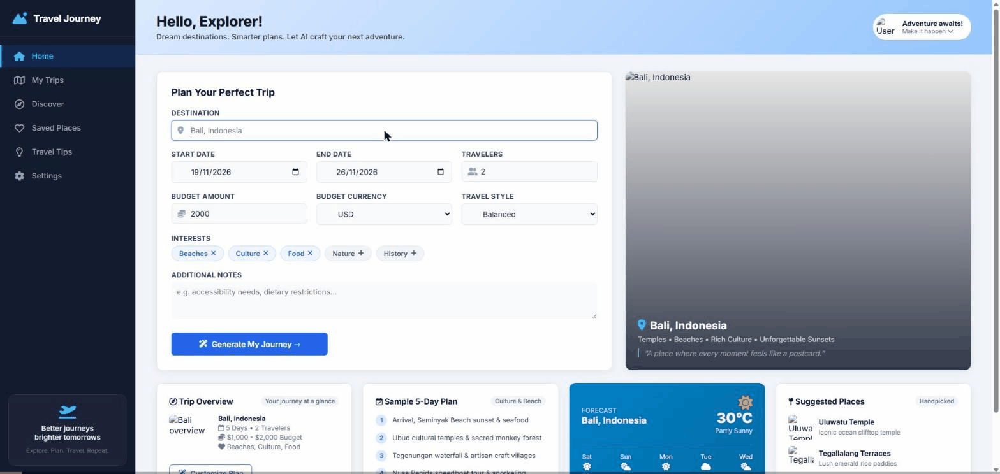
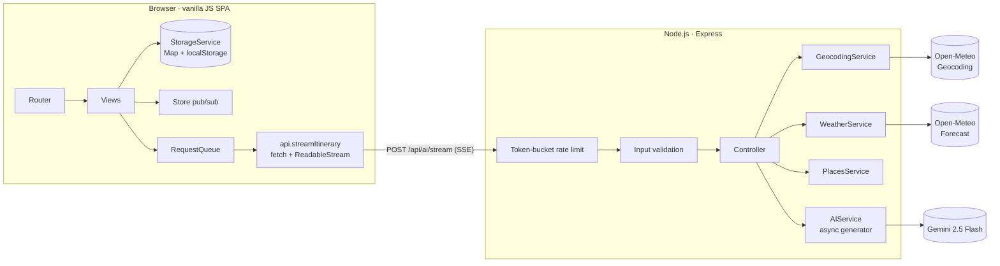

# Travel Journey

An AI travel planner built **without a frontend framework**: a vanilla-JavaScript single-page app plus a Node.js/Express API. The API geocodes the destination, pulls a live weather forecast and **streams an AI-generated itinerary to the browser token by token**.



## Highlights

- **Framework-free SPA.** History-API router with route patterns compiled to RegExps, `:param` extraction, query strings, 404 fallback, view lifecycle (`destroy()`) and event-delegated navigation.
- **End-to-end streaming.** An `async function*` generator on the server feeds Server-Sent Events over `POST`. The browser parses them with `ReadableStream` + `TextDecoder({ stream: true })` and a line buffer, so frames split across network chunks are handled correctly.
- **Cancellation everywhere.** If you leave the results page mid-generation, the browser aborts the `fetch`. The server sees the closed socket and aborts geocoding, weather and the Gemini call through a shared `AbortSignal`.
- **Live data, honest fallbacks.** [Open-Meteo](https://open-meteo.com/) provides geocoding and a daily forecast (free, no key), and Gemini 2.5 Flash writes the itinerary. If a service is unreachable or no API key is set, the app still works on demo data and **tells the user which parts are demo data**.
- **Secure by default.** Every user- or AI-supplied string is HTML-escaped before rendering. The API validates and whitelists its input, rate-limits AI endpoints, restricts CORS, caps body size and never leaks stack traces.
- **40 zero-dependency tests** with `node:test`, run in CI (Node 22 & 24) on every push.

## Data structures & algorithms

| Where | Structure / algorithm | Why |
|---|---|---|
| `frontend/src/services/storage-service.js` | `Map` keyed by trip id; insertion order kept sorted by `createdAt` | O(1) get/update/delete; newest-first listing in O(n) by reversing instead of re-sorting on every render |
| `backend/src/middleware/rate-limit.middleware.js` | **Token bucket** per client IP with lazy refill | O(1) per request, no per-client timers; allows short bursts while capping sustained cost of AI calls |
| `frontend/src/data-structures/request-queue.js` | Promise-based FIFO queue | Serialises AI generations so repeated clicks can't race each other; a failed task doesn't block the queue |
| `frontend/src/router/index.js` | Route patterns precompiled to RegExps | Matching is one regex test per route instead of string-splitting every pattern on every navigation |
| `frontend/src/pages/PlanView.js` | `Set` of selected interests | O(1) toggle with no duplicates; the DOM only reflects the Set |
| `frontend/src/utils/budget.js` | Strategy table (`luxury` / `adventure` / `balanced`) | Allocation is data, not branches; the last bucket absorbs rounding so the parts always sum to the total |
| `frontend/src/utils/dates.js` | Calendar-day arithmetic via `Date.UTC` | Trip length is correct across DST changes and timezones |
| `frontend/src/pages/ResultsView.js` | Streamed chunks appended as `Text` nodes | O(n) total work instead of re-copying the whole string per chunk |
| `frontend/src/utils/format.js` | Memoised `Intl.NumberFormat` per currency | Avoids rebuilding formatters on every render |

## Architecture



The controller geocodes first (the other services need coordinates), then fetches weather and places **in parallel** with `Promise.all`. It sends one `meta` SSE frame (coordinates, forecast, which sources are demo data) followed by the streamed itinerary chunks, then `[DONE]`. Errors after the stream has started are sent in-band as an `error` frame.

## Getting started

Requirements: **Node.js 22+**.

```powershell
# 1. Backend (http://localhost:3000)
cd backend
npm install
copy .env.example .env   # optional: add GEMINI_API_KEY for real AI itineraries
npm run dev
```

```powershell
# 2. Frontend (http://localhost:5173, proxies /api to the backend)
cd frontend
npm install
npm run dev
```

```powershell
# 3. Tests (from the repo root)
npm test
```

Without `GEMINI_API_KEY` the server runs in **demo mode**: it streams a deterministic itinerary built from your interests and trip length, so the whole UI can be explored offline.

### Environment variables (`backend/.env`)

| Variable | Default | Purpose |
|---|---|---|
| `GEMINI_API_KEY` | — | Enables real AI itineraries |
| `GEMINI_MODEL` | `gemini-2.5-flash` | Model override |
| `PORT` | `3000` | API port |
| `CORS_ORIGIN` | `http://localhost:5173` | Comma-separated allowed origins |
| `AI_RATE_LIMIT_BURST` | `5` | Token-bucket capacity per IP |
| `AI_RATE_LIMIT_PER_MINUTE` | `5` | Sustained refill rate per IP |

## Deploying to Vercel

The repo deploys as **one Vercel project with two [services](https://vercel.com/docs/services)** (see `vercel.json`):

| Service | Root | Framework | Public path |
|---|---|---|---|
| `backend` | `backend/` | Express (entrypoint `src/app.js`) | `/api/*` |
| `frontend` | `frontend/` | Vite (static SPA) | everything else |

Import the repository on [vercel.com/new](https://vercel.com/new) with **Root Directory `./`** and add `GEMINI_API_KEY` under *Environment Variables*. The SPA calls `/api/*` on its own domain, so no CORS setup is needed and no service bindings are required: the backend only calls external APIs (Open-Meteo, Nominatim, Gemini).

## Routes

| Path | View |
|---|---|
| `/` | Dashboard with the planning form |
| `/plan?destination=…` | Planning form (optionally prefilled) |
| `/results` | Live streaming itinerary, map, weather and budget |
| `/trips`, `/trips/:id` | Saved trips and trip details with editable notes |
| `/discover`, `/saved-places`, `/travel-tips`, `/settings` | Inspiration, bookmarks, tips, preferences |

## Security notes

- No secrets reach the browser; the Gemini key lives only on the server.
- All dynamic HTML goes through `escapeHTML()`; tests cover markup and `</textarea>` breakouts.
- Request bodies are validated and **whitelisted** before being placed in the prompt. The prompt tells the model to treat user notes as data, not instructions.
- AI endpoints are rate-limited; JSON bodies are capped at 20 KB; 5xx responses don't expose internals.

## Known limitations

- `PlacesService` is a stub (returns no places); the AI recommends places itself.
- Trips and bookmarks are stored in `localStorage`, per browser. There are no user accounts.
- The rate limiter is in-memory, so with multiple server instances you'd move buckets to Redis.

## Project structure

```text
backend/
  server.js                    Express app, CORS, body limits, 404 + error handling
  src/controllers/             Request orchestration and SSE streaming
  src/services/                Geocoding, weather (Open-Meteo), places, AI (Gemini)
  src/middleware/              Token-bucket rate limiter, logger, error handler
  src/validation/              Request validation / whitelisting
frontend/
  src/router/                  History-API router
  src/pages/                   Class-based views
  src/services/                Trip storage, settings
  src/state/                   Pub/sub store
  src/data-structures/         Request queue
  src/utils/                   Dates, budget, validation, escaping, formatting
tests/                         node:test suites (frontend utils/services, backend)
docs/                          Audit report and demo recording
```
